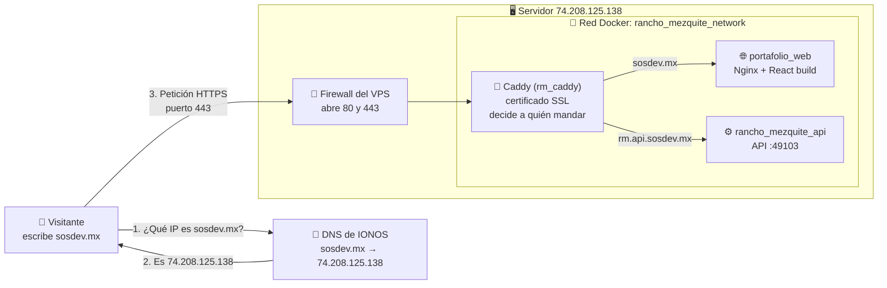
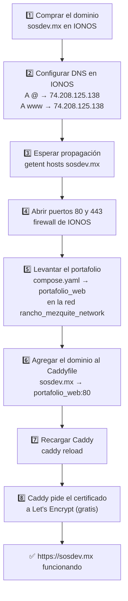
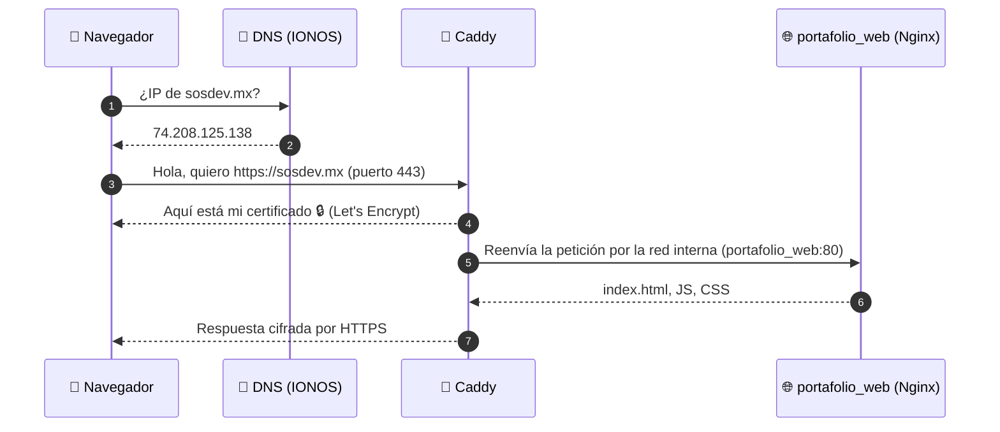
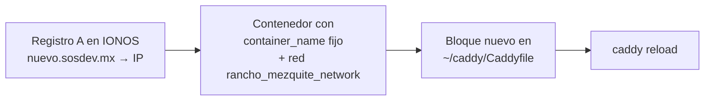

# Cómo llega alguien a `https://sosdev.mx`

Guía de cómo quedó publicado el portafolio con dominio propio y HTTPS, desde la compra del dominio hasta los contenedores. Suena complicado, pero son pocas piezas, y cada una hace una sola cosa.

---

## La idea en una imagen



**En resumen:** el dominio solo es un nombre que apunta a la IP del servidor. En el servidor, Caddy recibe todo lo que llega por los puertos 80 y 443, pone el candado HTTPS y, según el nombre que pidió el visitante, lo manda al contenedor que corresponde.

---

## El camino completo, paso a paso



---

## ¿Qué significa cada cosa?

| Concepto | Qué es | Analogía |
|---|---|---|
| **Dominio** (`sosdev.mx`) | Un nombre fácil de recordar que tú rentas por año. | El nombre de tu negocio. |
| **IP** (`74.208.125.138`) | La dirección real de tu servidor en internet. | La dirección física del local. |
| **DNS** | La "agenda" pública que traduce nombre → IP. Se configura en IONOS. | Google Maps: buscas el nombre y te da la dirección. |
| **Registro A** | Una línea del DNS que dice "este nombre apunta a esta IP". | Una entrada en la agenda. |
| **`@`** | El dominio principal sin nada antes (`sosdev.mx`). | — |
| **Subdominio** (`www`, `rm.api`) | Un nombre "hijo" del dominio (`www.sosdev.mx`, `rm.api.sosdev.mx`). No se compra aparte; solo se crea un registro A. | Sucursales del mismo negocio. |
| **Propagación** | El tiempo que tardan los servidores DNS del mundo en enterarse del cambio (minutos a horas). | Que se actualice el mapa. |
| **Puerto** | Una "puerta" numerada del servidor. 80 = HTTP, 443 = HTTPS. | Las puertas del edificio. |
| **Firewall** | Decide qué puertas están abiertas. Hay que abrir 80 y 443. | El guardia de la entrada. |
| **HTTPS / certificado SSL** | El candado 🔒: cifra la conexión y prueba que el sitio es tuyo. | Un gafete oficial verificado. |
| **Let's Encrypt** | Entidad que regala certificados SSL. Caddy los pide y renueva solo. | La oficina que emite los gafetes. |
| **Docker / contenedor** | Tu app empaquetada con todo lo que necesita, aislada del resto. | Un local prefabricado dentro del edificio. |
| **`compose.yaml`** | Archivo que describe cómo levantar los contenedores (imagen, red, puertos). | El plano de cada local. |
| **Red Docker** (`rancho_mezquite_network`) | Red interna donde los contenedores se ven por su nombre. | El pasillo interno del edificio. |
| **Reverse proxy** (Caddy) | El que recibe todas las visitas y las reenvía al contenedor correcto según el dominio. | La recepcionista que dice "usted va al piso 2". |
| **`Caddyfile`** | La configuración de Caddy: qué dominio va a qué contenedor. | La lista de la recepcionista. |
| **Nginx** (dentro del portafolio) | Servidor web que entrega los archivos del build de React. | El empleado que atiende dentro del local. |

---

## Qué pasa en una visita (en orden)



Si alguien entra por `http://` (puerto 80), Caddy lo redirige solo a `https://`.

---

## Los archivos que hacen la magia

### 1. DNS en IONOS

| Tipo | Host | Valor |
|---|---|---|
| A | `@` | `74.208.125.138` |
| A | `www` | `74.208.125.138` |
| A | `rm.api` | `74.208.125.138` |

Los tres apuntan a la **misma IP**. Quien distingue a dónde va cada uno es Caddy.

### 2. `compose.yaml` del portafolio (este repo)

```yaml
services:
  web:
    build:
      context: .
    container_name: portafolio_web        # nombre fijo para que Caddy lo encuentre
    restart: unless-stopped
    networks:
      - rancho_mezquite_network           # la misma red que Caddy

networks:
  rancho_mezquite_network:
    external: true                        # la red ya existe; no la crees otra vez
```

> No publica ningún puerto (`ports:`). Nadie de afuera entra directo al contenedor; todo pasa por Caddy.

### 3. `~/caddy/Caddyfile` (en el servidor, uno solo para todo)

```
rm.api.sosdev.mx {
    encode gzip
    reverse_proxy rancho_mezquite_api:49103
}

sosdev.mx, www.sosdev.mx {
    encode gzip
    reverse_proxy portafolio_web:80
}
```

- `sosdev.mx, www.sosdev.mx`: los dominios que atiende este bloque.
- `encode gzip`: comprime las respuestas para que carguen más rápido.
- `reverse_proxy portafolio_web:80`: reenvía al contenedor `portafolio_web`, puerto 80 interno.
- Caddy obtiene el certificado HTTPS de cada dominio que aparezca aquí, sin configurar nada más.

### 4. `~/caddy/compose.yaml` (el Caddy compartido)

```yaml
services:
  caddy:
    image: caddy:2
    container_name: rm_caddy
    restart: always
    ports:
      - "80:80"           # HTTP (y redirección a HTTPS)
      - "443:443"         # HTTPS
      - "443:443/udp"     # HTTP/3
    volumes:
      - ./Caddyfile:/etc/caddy/Caddyfile:ro
      - caddy_data:/data  # aquí guarda los certificados
      - caddy_config:/config
    networks:
      - rancho_mezquite_network

networks:
  rancho_mezquite_network:
    external: true

volumes:
  caddy_data:
  caddy_config:
```

> **Solo hay un Caddy.** Los puertos 80 y 443 solo los puede usar un programa a la vez. Para cada sitio nuevo no se crea otro Caddy: se agrega un bloque al `Caddyfile`.

---

## Comandos que se usaron

```bash
# Verificar que el dominio ya apunta al servidor
getent hosts sosdev.mx

# Levantar / actualizar el portafolio
cd ~/my-portafolio
docker compose up -d --build

# Comprobar que Caddy ve al portafolio por la red interna
docker exec rm_caddy wget -qO- http://portafolio_web/ | head -5

# Validar y recargar Caddy sin tumbar la API
docker exec rm_caddy caddy validate --config /etc/caddy/Caddyfile
docker exec -w /etc/caddy rm_caddy caddy reload --config /etc/caddy/Caddyfile

# Ver logs (esperar "certificate obtained successfully")
docker logs -f rm_caddy

# Probar
curl -I https://sosdev.mx
```

---

## Agregar otro sitio en el futuro (receta de 4 pasos)



1. En IONOS: registro **A** `nuevo` → `74.208.125.138`.
2. En el `compose.yaml` del proyecto: `container_name` y la red `rancho_mezquite_network` (external).
3. En `~/caddy/Caddyfile`:
   ```
   nuevo.sosdev.mx {
       reverse_proxy nombre_del_contenedor:PUERTO_INTERNO
   }
   ```
4. `docker exec -w /etc/caddy rm_caddy caddy reload --config /etc/caddy/Caddyfile`

Listo: HTTPS incluido, sin comprar certificados.

---

## Si algo falla

| Síntoma | Causa probable | Qué hacer |
|---|---|---|
| El dominio no carga nada | DNS sin propagar o apuntando a otra IP | `getent hosts sosdev.mx` debe dar `74.208.125.138` |
| Error de certificado | Caddy intentó antes de que el DNS propagara | Esperar y `docker restart rm_caddy` |
| **502 Bad Gateway** | Caddy no encuentra el contenedor | Revisar que `portafolio_web` esté arriba y en la red `rancho_mezquite_network` |
| `network ... not found` | La red no existe (la API no está levantada) | Levantar primero la API |
| Cambié el Caddyfile y no hace caso | Se editó con vim/nano y el contenedor ve el archivo viejo | `cd ~/caddy && docker compose restart` |
| `port is already allocated` | Otro programa usa el 80/443 | No levantar un segundo Caddy; usar el existente |
